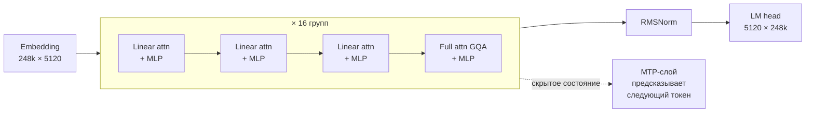

# ДЗ №1. Qwen3.8-27B на RTX 3060: где тормозит и как ускорить

Курс «Дистилляция и ускорение моделей», ИПИИ НИУ ВШЭ.

Все цифры в отчёте получены на реальном железе (см. [`RESULTS.md`](RESULTS.md) и сырые данные в [`results/`](results/)). Расчётные значения помечены как расчётные.

**Коротко.** Модель на 27 млрд параметров в BF16 весит 55 ГБ, а у видеокарты 12 ГБ. Поэтому главное ограничение — **объём видеопамяти**, а главное узкое место при генерации — **пропускная способность памяти**. Комбинация «3-битная квантизация, чтобы вся модель поместилась в GPU» + FlashAttention + встроенный MTP ускорила генерацию с 7,6 до 38,8 токена/с (**примерно в 5 раз**) относительно 4-битной модели с частичной выгрузкой на CPU. Цена — +3,4% к перплексии и почти весь запас видеопамяти.

---

## 1. Модель и сценарий применения

**Модель:** [Qwen3.8-27B](https://huggingface.co/Qwen/Qwen3.8-27B) — открытая мультимодальная (текст и изображения) LLM, выпущена в августе 2026. Плотная, не MoE: на каждый токен работают все 27 млрд параметров.

**Задача:** локальный ассистент для одного пользователя — ответы на вопросы по своим документам и коду (RAG), объяснения, генерация кода.

**Почему локально:** документы и код не должны уходить во внешний API; нет абонентской платы; работает без интернета.

**Режим:** только **инференс**, онлайн, интерактивный (пользователь ждёт ответа и читает его по мере генерации). Обучение и дообучение на этой платформе не рассматриваются.

**Нагрузка:**

| Параметр | Значение |
|---|---|
| Пользователей одновременно | 1 (batch = 1) |
| Запросов | десятки–сотни в день, по одному |
| Длина промпта | 2–8 тыс. токенов (системный промпт + найденные фрагменты документов + вопрос) |
| Длина ответа | 200–800 токенов |
| Требование к первому токену (TTFT) | желательно ≤ 3–5 с |
| Требование к скорости генерации | ≥ 15–20 ток/с (не медленнее, чем человек читает) |

**Почему именно эта модель, а не 7–8B, которая влезает без проблем:** 27B заметно сильнее в рассуждениях и коде, и вопрос «можно ли запустить её на массовой видеокарте с приемлемой скоростью» — это и есть реальная инженерная задача. Модель, которая и так влезает, не дала бы что ускорять.

## 2. Целевая платформа

Домашний ПК под Pop!_OS 22.04 — типичная «одна игровая видеокарта».

| Компонент | Характеристики | Что это значит для LLM |
|---|---|---|
| GPU | NVIDIA RTX 3060, 12 ГБ GDDR6, шина 192 бит, **~360 ГБ/с** | Всё, что не влезло в 12 ГБ, работает в разы медленнее |
| Тензорные ядра (Ampere, sm_86) | ~51 TFLOPS FP16 и ~102 TOPS INT8 (dense, оценка по числу SM и частоте) | Для prefill вычислений достаточно |
| Нет FP8 | FP8 появился только в Ada/Hopper | FP8-чекпойнты (`Qwen3.8-27B-FP8`) аппаратно не ускоряются |
| CPU | AMD Ryzen 7 7700, 8 ядер | Может считать часть слоёв, но медленно |
| RAM | 30 ГБ DDR5, двухканальная, **~53 ГБ/с измерено** | В ~7 раз медленнее видеопамяти. BF16-модель (55 ГБ) не влезает даже сюда |
| Связь CPU↔GPU | PCIe | При частичной выгрузке llama.cpp считает слои на CPU, а не гоняет веса по шине |
| Энергопотребление | GPU до 170 Вт | Для домашнего сценария некритично |

Видеокарта не выделенная: на ней же работают рабочий стол (~150 МБ) и бот для расшифровки аудио (~200 МБ во время замеров, до 1,4 ГБ под нагрузкой). Реально доступно около 11,9 ГБ.

## 3. Архитектура модели

Параметры взяты из [`config.json`](https://huggingface.co/Qwen/Qwen3.8-27B/blob/main/config.json).

**Ключевые размерности:** 64 слоя, hidden 5120, MLP 17 408 (SwiGLU), словарь 248 320, контекст до 262 144 токенов.

**Гибридный стек: на каждые 3 слоя линейного attention приходится 1 слой полного.**

| Блок | Сколько | Устройство | Что хранит при генерации |
|---|---|---|---|
| Линейный attention | 48 слоёв | Gated-DeltaNet-подобный слой (как в Qwen3-Next): 16 голов Q/K и 48 голов V по 128, короткая свёртка (ядро 4), выходной гейт | **Состояние фиксированного размера**: ~3 МБ на слой, не растёт с длиной контекста |
| Полный attention | 16 слоёв | GQA: 24 головы Q, **4 головы KV**, head_dim 256, частичный RoPE (25% измерений), выходной гейт | **KV-кэш, растущий с контекстом** |
| MLP (SwiGLU) | 64 | 5120 → 2 × 17 408 → 5120 | — |
| MTP-голова | 1 слой | Блок, похожий на слой полного attention; предсказывает токен на шаг вперёд | Используется для спекулятивного декодирования |

**Где живут параметры** (оценка по размерностям, текстовая часть):

| Часть | Параметров | Доля |
|---|---|---|
| MLP (64 × 3 × 5120 × 17 408) | ~17,1 млрд | **~63%** |
| Линейный attention (48 слоёв) | ~5,5 млрд | ~20% |
| Полный attention (16 слоёв) | ~1,7 млрд | ~6% |
| Embedding + LM head (не связаны) | ~2,5 млрд | ~9% |

**Что самое ресурсоёмкое:**
- **По памяти и времени генерации — MLP.** Около двух третей весов, и все их нужно прочитать на каждом шаге.
- **По вычислениям на длинном промпте** — тоже матричные умножения MLP и проекций. Квадратичная часть (сам attention) есть только в 16 слоях из 64, поэтому она вторична.
- **По памяти, растущей с контекстом — KV-кэш 16 слоёв полного attention.** Расчёт: 16 слоёв × 4 KV-головы × 256 × 2 (K и V) × 2 байта = **64 КиБ на токен**. Замер это подтвердил (см. раздел 4). Если бы все 64 слоя были полными, было бы 256 КиБ на токен, а без GQA (24 KV-головы) — 1,5 МиБ.
- **LM head** с огромным словарём (248 тыс.) — ~1,3 млрд параметров, читается на каждом токене.

## 4. Вычислительные затраты и узкие места

### Две фазы с разной природой

Генерация ответа состоит из двух фаз, и упираются они в разное.

| Фаза | Что происходит | Арифметическая интенсивность (оценка) | Во что упирается на 3060 |
|---|---|---|---|
| **Prefill** (обработка промпта) | Все токены промпта проходят через модель одной пачкой | ~2 × N_токенов операций на байт весов → тысячи | **В вычисления** |
| **Decode** (генерация) | По одному токену за шаг, на каждом шаге читаются **все веса** | ~2 операции на параметр ÷ ~0,4 байта на параметр ≈ **5 оп/байт** | **В пропускную способность памяти** |

Баланс машины RTX 3060 ≈ 102 TOPS / 360 ГБ/с ≈ **280 операций на байт**. Decode с интенсивностью ~5 оп/байт находится в глубоко «memory-bound» области roofline-модели: тензорные ядра простаивают больше 95% времени.

**Теоретический потолок decode** = пропускная способность ÷ байты весов на токен:

| Вариант | Веса | Потолок | Измерено | % потолка |
|---|---|---|---|---|
| BF16 | 55,6 ГБ | — | **не влезает ни в VRAM, ни в RAM** | — |
| IQ3_XXS (~3,06 бит/вес) | 10,93 ГБ | 32,9 ток/с | 21,0 ток/с | 64% |
| Q2_K_XL | 9,83 ГБ | 36,6 ток/с | 21,7 ток/с | 59% |

**Prefill:** 619 ток/с × 2 × 27,3 млрд ≈ **34 TOPS** — около трети от пика INT8 тензорных ядер. Это нормально для квантованных матричных умножений с распаковкой весов.

### Перечень узких мест

**B1. Пропускная способность видеопамяти на decode — главное узкое место.**
Чтобы сгенерировать один токен, нужно прочитать ~11 ГБ весов. При 360 ГБ/с это даёт потолок ~33 ток/с при любой вычислительной мощности. Возникает из-за авторегрессии (токены строго по одному) и batch = 1 (не с кем разделить чтение весов).

**B2. Объём видеопамяти — главное ограничение платформы.**
Он определяет почти всё остальное:
- модель в BF16 (55 ГБ) не влезает в 12 ГБ → квантизация обязательна;
- даже 4 бита (16,5 ГБ) не влезают → либо 3 бита, либо выгрузка на CPU;
- с f16 KV-кэшем влезает только ~16 тыс. токенов контекста (32 тыс. → cudaMalloc на 2 ГиБ не удался);
- MTP с черновиком ≥ 3 токенов падает с CUDA out of memory.

**B3. Оперативная память при частичной выгрузке.**
Слои, оставшиеся на CPU, читаются из DDR5 на ~53 ГБ/с (Q4_K_M целиком на CPU: 16,46 ГБ × 3,2 ток/с). Время на токен ≈ (веса на GPU)/360 + (веса в RAM)/53. Медленная часть **складывается последовательно** с быстрой и доминирует: 15% слоёв на CPU отнимают 36% скорости (IQ3_XXS: 21,0 → 13,5 ток/с при 56 из 65 слоёв на GPU).

| Слоёв на GPU (из 65) | Q4_K_M, ток/с | IQ3_XXS, ток/с |
|---|---|---|
| 0 | 3,2 | — |
| 32 | 5,6 | 7,0 |
| 44 | 7,6 (максимум, что влезает) | — |
| 48 | — | 10,7 |
| 56 | — | 13,5 |
| 65 | не влезает | **21,0** |

**B4. Prefill → долгое ожидание первого токена в RAG.**
Prefill ~600 ток/с — это мало для RAG-сценария, где промпт длинный: 2 тыс. токенов → **3,3 с**, 8 тыс. → **14,0 с** до первого токена. Причина — 27 млрд параметров × тысячи токенов операций; здесь уже упираемся в вычисления, и квантизация весов не помогает.

**B5. Attention на длинном контексте — небольшое узкое место благодаря архитектуре.**
С ростом контекста растёт работа только в 16 слоях полного attention. Decode на 8 тыс. токенов контекста замедляется всего на **3,8%** (21,22 → 20,41 ток/с), prefill — на 10%. У обычного трансформера этого размера эффект был бы заметно сильнее. Без FlashAttention на глубине 8 тыс. decode медленнее на 14% (17,4 против 20,2 ток/с).

**B6. Распаковка весов при очень низкой разрядности.**
Q2_K_XL на 10% меньше IQ3_XXS по объёму, но быстрее всего на 3%. Значит, при ~2,5–3 битах доля времени на распаковку весов и прочие операции (свёртки, обновление состояния линейного attention, нормализации) уже сравнима с чтением — дальнейшее снижение разрядности почти не ускоряет.

## 5. Системные ограничения

| Ограничение | Значение | Критичность для сценария |
|---|---|---|
| Объём VRAM | ~11,9 ГБ доступно | **Критично.** Определяет, какая квантизация возможна, сколько контекста влезает и можно ли включить MTP |
| Пропускная способность VRAM | ~360 ГБ/с | **Критично.** Задаёт потолок скорости генерации |
| Скорость генерации | ≥ 15–20 ток/с | **Критично** для интерактивности. Q4 с выгрузкой (7,6) не проходит, IQ3 на GPU (21) — проходит |
| Время до первого токена | ≤ 3–5 с | **Критично для RAG.** При 600 ток/с prefill промпт должен быть ≤ ~2–3 тыс. токенов, либо нужен кэш префикса |
| Контекст | 2–8 тыс. обычно, до 16 тыс. иногда | Умеренно. 8 тыс. влезает с запасом, 16 тыс. — только с q8 KV-кэшем |
| Пропускная способность по запросам | 1 пользователь | Некритично. Batching не нужен |
| RAM | 30 ГБ, ~53 ГБ/с | Ограничивает только варианты с выгрузкой |
| Энергопотребление | ≤ 170 Вт GPU | Некритично для домашнего сценария |
| Общая GPU с другими процессами | ~0,4–1,5 ГБ занято | Умеренно: при нагрузке бота запас VRAM исчезает |

**Пример полного запроса** (промпт 4 тыс. токенов, ответ 400 токенов; расчёт из измеренных скоростей):

| Конфигурация | Prefill | Генерация | Итого |
|---|---|---|---|
| Q4_K_M, 44 слоя на GPU | 4096 / 474 ≈ 8,6 с | 400 / 7,6 ≈ 53 с | **~61 с** |
| IQ3_XXS на GPU | 4096 / 612 ≈ 6,7 с | 400 / 21 ≈ 19 с | **~26 с** |
| IQ3_XXS + MTP | ≈ 6,7 с | 400 / 36 ≈ 11 с | **~18 с** |

После ускорения decode доля prefill в общем времени выросла с 14% до 37% — следующим узким местом становится уже он (B4).

## 6. Гипотезы по ускорению

Для каждого метода указано, по какому узкому месту он бьёт. Методы 1–5 проверены на стенде, 6–9 — гипотезы, которые не проверялись.

### Проверено

**1. Квантизация весов до 3 бит (IQ3_XXS) и размещение всей модели на GPU** → B1, B2, B3.
- *Что затрагивает:* все линейные слои (MLP, проекции attention, LM head).
- *За счёт чего:* в 5 раз меньше байт на токен, чем в BF16; модель целиком помещается в VRAM и не упирается в медленную RAM.
- *Результат:* **7,6 → 21,0 ток/с** (×2,8 относительно Q4_K_M с выгрузкой).
- *Когда имеет смысл:* decode упирается в память, и модель иначе не влезает.
- *Когда нет:* не ускоряет prefill (B4); при ещё меньшей разрядности (Q2) выигрыша почти нет из-за B6, а качество падает.

**2. Квантизация KV-кэша до q8_0** → B2.
- *Что затрагивает:* KV-кэш 16 слоёв полного attention.
- *За счёт чего:* вдвое меньше памяти на токен контекста.
- *Результат:* контекст 16 тыс. токенов стал возможен (с f16 не влезал), decode 18,5 ток/с.
- *Когда имеет смысл:* нужен длинный контекст.
- *Когда нет:* на коротком контексте только теряем ~1–4% скорости. Здесь KV-кэш и так маленький благодаря гибридной архитектуре и GQA, поэтому метод менее важен, чем для обычного трансформера.

**3. FlashAttention** → B5.
- *Что затрагивает:* 16 слоёв полного attention.
- *За счёт чего:* слияние ядер (kernel fusion) — softmax и умножения считаются блоками в быстрой памяти, без записи матрицы внимания в VRAM.
- *Результат на глубине 8 тыс.:* decode **+16%**, prefill **+10%**.
- *Когда нет:* на коротком контексте эффект близок к нулю.

**4. Встроенное спекулятивное декодирование через MTP** → B1.
- *Что затрагивает:* decode целиком; использует MTP-голову, уже обученную вместе с моделью (по сути — встроенная дистиллированная draft-модель).
- *За счёт чего:* MTP-голова предлагает 1–2 следующих токена, основная модель проверяет их **одним** проходом. Веса читаются один раз, а за проход получается в среднем **2,8 токена на коде и 2,4 на прозе** (384 токена за 139 и 157 проходов). Это прямой обход memory-bound природы decode. Итоговое ускорение меньше числа токенов за проход, потому что сам MTP-слой и проверка нескольких токенов тоже стоят времени.
- *Результат (черновик 2 токена):* **38,8 ток/с на коде** (×1,86, принимается 89% черновиков) и **34,4 на прозе** (×1,66, принимается 73%).
- *Когда имеет смысл:* batch = 1, decode упирается в память — ровно наш случай. При greedy-декодировании выдача не меняется.
- *Когда нет:* при большом batch (GPU и так загружен вычислениями); при ограниченной памяти — у нас черновик ≥ 3 токенов не влез (OOM). На менее предсказуемом тексте выигрыш меньше.

**5. Отказ от выгрузки на CPU** → B3.
Даже небольшая доля слоёв на CPU непропорционально замедляет всё (см. таблицу B3). Лучше взять более агрессивную квантизацию, но держать всё на GPU.

### Не проверялось

**6. Кэширование префикса (prompt caching)** → B4.
Системный промпт и часто используемые документы обрабатываются один раз, их KV-кэш и состояние линейных слоёв переиспользуются. Должно резко сократить время до первого токена на повторяющихся запросах. *Сложность:* у гибридной модели нужно кэшировать не только KV, но и рекуррентное состояние, причём только для точно совпадающего префикса. *Не поможет* при каждый раз новых документах.

**7. Дистилляция 27B в меньшую плотную модель (~8–14B)** → B1, B2, B4.
Уменьшение модели ускоряет обе фазы, включая prefill, и освобождает VRAM под контекст. Логично сочетать с **структурным прунингом** (подход Minitron: обрезать слои и каналы MLP, затем восстановить качество дистилляцией), так как ~63% весов — в MLP. *Цена:* потеря качества на сложных задачах и большие затраты на обучение — на одной RTX 3060 дистилляцию 27B провести нереально, нужен кластер. *Когда нет:* если важно именно качество 27B.

**8. Более качественная 3–4-битная квантизация (AWQ/GPTQ-подобная, с калибровкой) или 3,5 бита** → B2.
Позволила бы приблизить качество к Q4_K_M при размере, который влезает. Например, между IQ3_XXS (10,9 ГБ) и Q4 (16,5 ГБ) есть IQ3_S (12,0 ГБ) — но он, скорее всего, уже не влезет в 11,9 ГБ вместе с контекстом (не проверялось).

**9. Обрезка словаря / LM head** → B1.
LM head на 248 тыс. токенов — ~1,3 млрд параметров, ~5% чтения на каждом токене. Для одноязычного сценария можно урезать словарь. *Цена:* сложное внедрение, ломает совместимость с токенизатором.

### Что здесь не имеет смысла

| Метод | Почему не подходит |
|---|---|
| Continuous batching, увеличение batch | Пользователь один, запросы идут по одному |
| FP8 | Нет аппаратной поддержки на Ampere |
| Тензорный/конвейерный параллелизм | Одна видеокарта |
| Разреженность 2:4 | Ampere умеет, но llama.cpp её не поддерживает, а для LLM без дообучения качество заметно падает |
| Ещё более низкая разрядность (Q2, IQ2) | Скорость почти не растёт (B6), качество падает |

## 7. Инженерные компромиссы

| Решение | Выигрыш | Цена |
|---|---|---|
| Q4_K_M → IQ3_XXS целиком на GPU | **×2,8** к генерации (7,6 → 21,0 ток/с), prefill ×1,3 | **+3,4%** к перплексии (5,93 → 6,13). Сильнее всего страдают код, математика, редкие языки. Почти не остаётся VRAM |
| IQ3_XXS → Q2_K_XL | +3% скорости, −1,1 ГБ | **+5,7%** к перплексии относительно Q4. Невыгодно |
| KV-кэш q8_0 | Контекст 16 тыс. вместо ~8–16 тыс. | −1–4% к скорости, небольшой риск ошибок на длинном контексте |
| FlashAttention | +10–16% на длинном контексте | Практически бесплатно (включено по умолчанию) |
| MTP, черновик 2 токена | **×1,7–1,9** к генерации | Качество не меняется (greedy). Нужна дополнительная VRAM под контекст черновика (точный объём не измерялся); чувствительно к настройкам — с черновиком ≥ 3 и по умолчанию падает с OOM. Выигрыш зависит от предсказуемости текста |
| Всё на GPU, без выгрузки | Предсказуемая скорость | Вся VRAM занята; другие задачи на GPU (бот) могут вызвать нехватку памяти |
| Дистилляция в меньшую модель (гипотеза) | Ускорение обеих фаз, запас VRAM | Качество, недели обучения на чужом железе, поддержка своей модели |

**Что выигрываем в итоге:** генерация **~5 раз быстрее** (7,6 → 38,8 ток/с), полный ответ RAG-ассистента — с ~61 до ~18 с.

**Чем платим:**
- **качеством:** +3,4% к перплексии из-за 3-битных весов;
- **запасом памяти:** контекст ограничен ~16 тыс. токенов, VRAM занята почти полностью, длина MTP-черновика упёрлась в память;
- **сложностью:** конфигурация хрупкая — изменение контекста, длины черновика или запуск другого процесса на GPU может привести к OOM;
- **время до первого токена не улучшилось:** на длинных промптах (8 тыс. токенов → 14 с) prefill стал следующим узким местом.

**Рекомендуемая конфигурация:** IQ3_XXS целиком на GPU + FlashAttention + MTP (черновик 2) + контекст 8 тыс. токенов (с q8 KV-кэшем, если нужно 16 тыс.). Сочетание MTP с контекстом 16 тыс. отдельно не проверялось.

---

## Методика и ограничения замеров

- **Движок:** [llama.cpp](https://github.com/ggml-org/llama.cpp) `a4d4f2f`, собран с CUDA 12.4, `-DCMAKE_CUDA_ARCHITECTURES=86`.
- **Веса:** GGUF [unsloth/Qwen3.8-27B-GGUF](https://huggingface.co/unsloth/Qwen3.8-27B-GGUF): `UD-IQ3_XXS`, `UD-Q2_K_XL`, `UD-Q4_K_M`.
- **Скорость:** `llama-bench`, 2–3 повтора; разброс между повторами < 1% везде, кроме prefill Q4_K_M на CPU (±4%).
- **Качество:** `llama-perplexity` на wikitext-2, 40 фрагментов по 512 токенов. Это **относительное** сравнение квантизаций; эталон BF16 недоступен — модель не влезает ни в VRAM, ни в RAM. Перплексия на wikitext для instruct-модели — грубая оценка; доверительные интервалы (±0,14) пересекаются, но фрагменты одинаковые, поэтому разность между квантизациями надёжнее, чем сами значения.
- **MTP:** `llama-server --spec-type draft-mtp`, 2 промпта (код и проза), 384 токена, temperature 0, 2 повтора (результаты повторов совпали).
- **Что не измерялось:** накладные расходы на запуск ядер, энергопотребление, качество на реальных RAG-задачах, сочетание MTP с длинным контекстом.
- На GPU параллельно работал другой процесс (~200 МБ VRAM).

**Воспроизведение:** [`run_bench_27b.sh`](run_bench_27b.sh) (скорость, выгрузка, контекст, перплексия) и [`mtp_test.sh`](mtp_test.sh) (MTP). Пути к llama.cpp и моделям прописаны в начале скриптов.

## Источники

1. Qwen Team. *Qwen3.8-27B* — карточка модели и `config.json`. https://huggingface.co/Qwen/Qwen3.8-27B
2. unsloth. *Qwen3.8-27B-GGUF*. https://huggingface.co/unsloth/Qwen3.8-27B-GGUF
3. ggml-org. *llama.cpp*. https://github.com/ggml-org/llama.cpp
4. NVIDIA. *GeForce RTX 3060 Family* — характеристики. https://www.nvidia.com/en-us/geforce/graphics-cards/30-series/rtx-3060-3060ti/
5. Williams S., Waterman A., Patterson D. *Roofline: An Insightful Visual Performance Model for Multicore Architectures*. Communications of the ACM, 2009.
6. Yang S., Kautz J., Hatamizadeh A. *Gated Delta Networks: Improving Mamba2 with Delta Rule*. ICLR 2025. arXiv:2412.06464
7. Ainslie J. et al. *GQA: Training Generalized Multi-Query Transformer Models from Multi-Head Checkpoints*. 2023. arXiv:2305.13245
8. Dao T. *FlashAttention-2: Faster Attention with Better Parallelism and Work Partitioning*. 2023. arXiv:2307.08691
9. Leviathan Y., Kalman M., Matias Y. *Fast Inference from Transformers via Speculative Decoding*. ICML 2023. arXiv:2211.17192
10. Gloeckle F. et al. *Better & Faster Large Language Models via Multi-token Prediction*. 2024. arXiv:2404.19737
11. DeepSeek-AI. *DeepSeek-V3 Technical Report* (MTP для спекулятивного декодирования). 2024. arXiv:2412.19437
12. Frantar E. et al. *GPTQ: Accurate Post-Training Quantization for Generative Pre-trained Transformers*. 2022. arXiv:2210.17323
13. Lin J. et al. *AWQ: Activation-aware Weight Quantization for LLM Compression and Acceleration*. 2023. arXiv:2306.00978
14. Hinton G., Vinyals O., Dean J. *Distilling the Knowledge in a Neural Network*. 2015. arXiv:1503.02531
15. Muralidharan S. et al. *Compact Language Models via Pruning and Knowledge Distillation* (Minitron). 2024. arXiv:2407.14679
16. Merity S. et al. *Pointer Sentinel Mixture Models* (WikiText-2). 2016. arXiv:1609.07843
